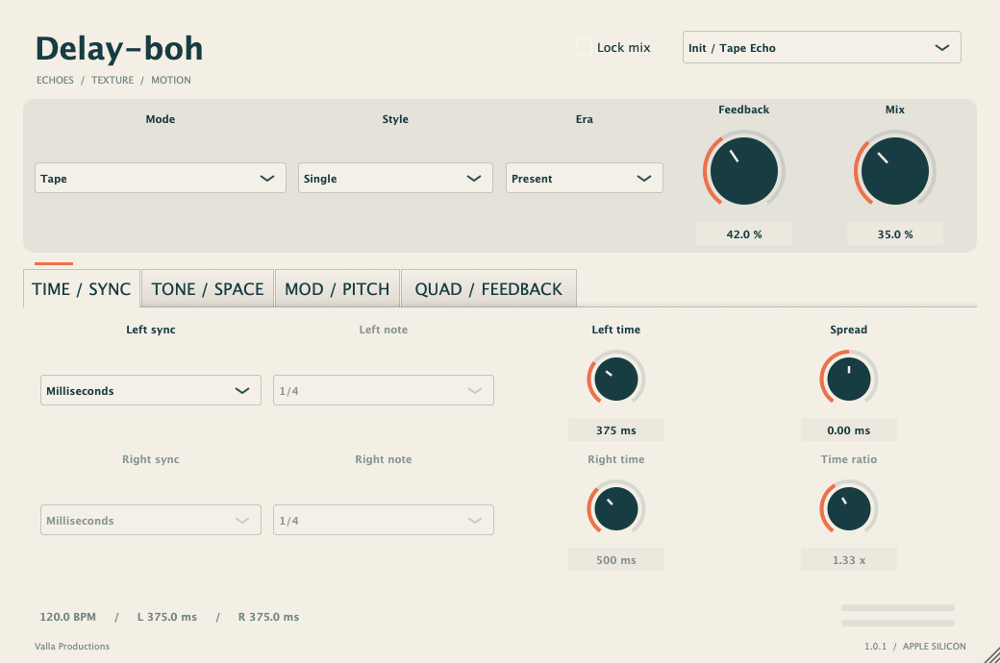

# Delay-boh

Plug-in delay gratuito di **Valla Productions**, versione **1.0.1**, per **macOS Apple Silicon (VST3 e Audio Unit)** e **Windows x64 (VST3)**.

[Scarica per macOS Apple Silicon](https://github.com/vallaproductionsoriginal-byte/Delay-boh/releases/download/v1.0.1/Delay-boh-1.0.1-mac-arm64.zip) · [Scarica per Windows x64](https://github.com/vallaproductionsoriginal-byte/Delay-boh/releases/download/v1.0.1/Delay-boh-1.0.1-win-x64.zip) · [Tutte le release](https://github.com/vallaproductionsoriginal-byte/Delay-boh/releases)



## Requisiti

- **macOS:** Mac Apple Silicon (arm64), macOS 11 o successivo e DAW o host VST3/AU arm64.
- **Windows:** Windows 10/11 a 64 bit e DAW o host VST3 x64.

## Installazione

1. Scarica lo ZIP per il tuo sistema ed estrailo completamente.
2. Su **macOS**, copia `Delay-boh.vst3` in `~/Library/Audio/Plug-Ins/VST3/` oppure `Delay-boh.component` in `~/Library/Audio/Plug-Ins/Components/`. Puoi installare entrambi. Crea le cartelle se mancano; nel Finder puoi aprire ciascun percorso con **Vai → Vai alla cartella…**.
3. Su **Windows**, copia l'intera cartella `Delay-boh.vst3` in `C:\Program Files\Common Files\VST3\` (può richiedere i permessi di amministratore), oppure in una cartella VST3 personalizzata supportata dalla DAW. Mantieni intatti `Contents`, binario e risorse.
4. Riavvia la DAW o avvia una nuova scansione dei plug-in, poi carica **Delay-boh** tra gli effetti di **Valla Productions**.

Lo ZIP macOS include VST3 e AU; quello Windows include VST3 x64. La redistribuzione richiede la previa autorizzazione scritta del titolare. In caso di redistribuzione autorizzata, conserva `LICENSE`, `THIRD_PARTY_NOTICES.md` e la cartella `licenses`. Una copia delle licenze è inclusa anche nei bundle.

I bundle macOS hanno una firma ad hoc e non sono notarizzati da Apple. macOS potrebbe richiedere un'autorizzazione di sicurezza: dopo un eventuale blocco, controlla **Impostazioni di Sistema → Privacy e sicurezza** e autorizza il plug-in solo se proviene da questa release. Il VST3 Windows usa il runtime C++ statico, senza richiedere un'installazione separata del Visual C++ Redistributable; non ha una firma Authenticode.

## Funzioni

- 17 modalità: Tape, HiFi, BBD, Digital, Ghost, Pitch, RevPitch, DuckTape, Clarity, BBDuck, LoFi, Analog, ChromeTape, Quartz, PhaserDDL, PitchDuck e RichPitch.
- 5 stili: Single, Dual, Ratio, PingPong e Quad; tempi da 1 ms a 10 secondi.
- Sync al BPM dell'host, note regolari, puntate e terzinate.
- Quattro tap, feedback positivo o negativo, Repeat/Swell e ducking.
- Drive, age, era, width, filtri low/high cut e diffusione.
- Wow/flutter, frequency shift, pitch shift, reverse e phaser.
- 38 parametri automatizzabili, nove preset di partenza e Mix Lock.
- Ingresso e uscita stereo o mono.

Per impostare il tempo destro in modo indipendente, usa Dual, PingPong o Quad. Le pagine Time/Sync, Tone/Space, Mod/Pitch e Quad/Feedback raggruppano gli altri controlli. Doppio clic su un controllo continuo per ripristinarne il valore iniziale.

## Verifica della release

La release include un file con il checksum SHA-256 tra gli allegati. Dopo aver scaricato lo ZIP e il file `.sha256` nella stessa cartella, puoi verificarlo con:

```sh
shasum -a 256 -c Delay-boh-1.0.1-mac-arm64.zip.sha256
```

Build arm64 e firme dei bundle verificate, test DSP e host VST3/AU superati, Audio Unit validato con `auval`. La versione è stata verificata su un Mac Apple Silicon; non sono dichiarati test su tutte le versioni di macOS o su tutte le DAW.

La build Windows è compilata con Visual Studio 2022 su un runner Windows x64. Superati i test DSP e host VST3 sul bundle del pacchetto: scansione, produttore, istanziazione, parametri, audio stereo/mono, automazione, stato, editor e controlli L/R. Verificati il binario PE32+ AMD64 e le dipendenze dal sistema. Non sono dichiarati test su tutte le DAW o su ogni versione di Windows.

Per lo ZIP Windows, confronta il risultato di questo comando PowerShell con il valore nel file `.sha256` allegato:

```powershell
Get-FileHash .\Delay-boh-1.0.1-win-x64.zip -Algorithm SHA256
```

## Licenza

Delay-boh e la documentazione del progetto sono distribuiti sotto [licenza proprietaria](LICENSE). L'uso richiede l'autorizzazione espressa del titolare, nei limiti concessi. Modifiche e redistribuzione richiedono la previa autorizzazione scritta del titolare. Questa release distribuisce il plug-in compilato; i sorgenti non sono inclusi.

Le componenti di terze parti mantengono le proprie licenze. JUCE 9.0.3 è utilizzato dal distributore sotto licenza commerciale **JUCE Starter**. Le attribuzioni e i testi delle licenze sono in [THIRD_PARTY_NOTICES.md](THIRD_PARTY_NOTICES.md) e nella cartella [licenses](licenses).

## Problemi e feedback

Segnala problemi tramite le [Issues](https://github.com/vallaproductionsoriginal-byte/Delay-boh/issues), indicando sistema operativo e versione, computer, DAW e passaggi per riprodurli.
